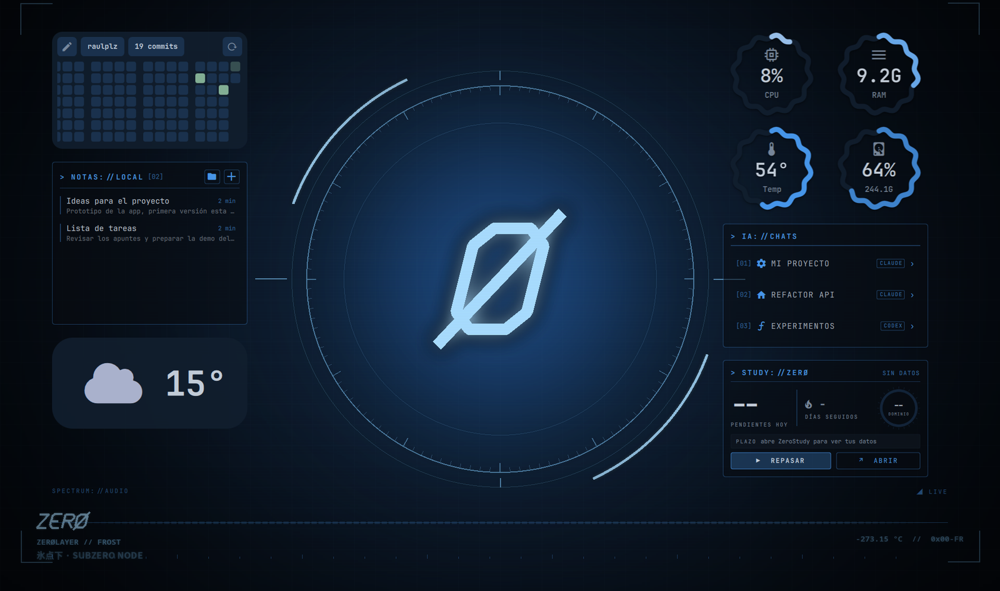
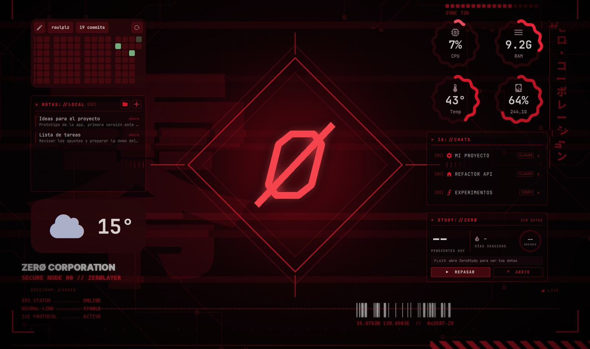
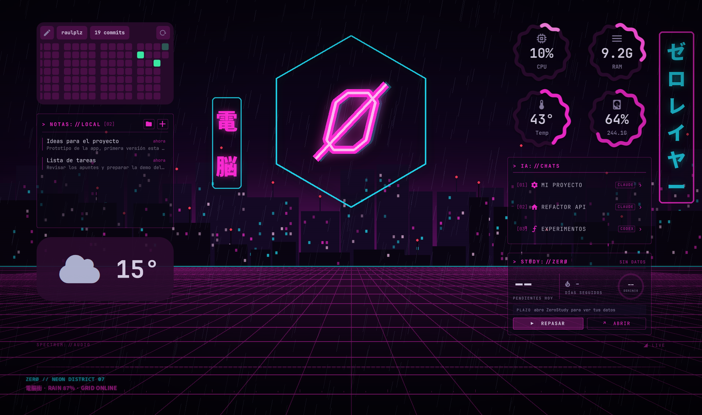
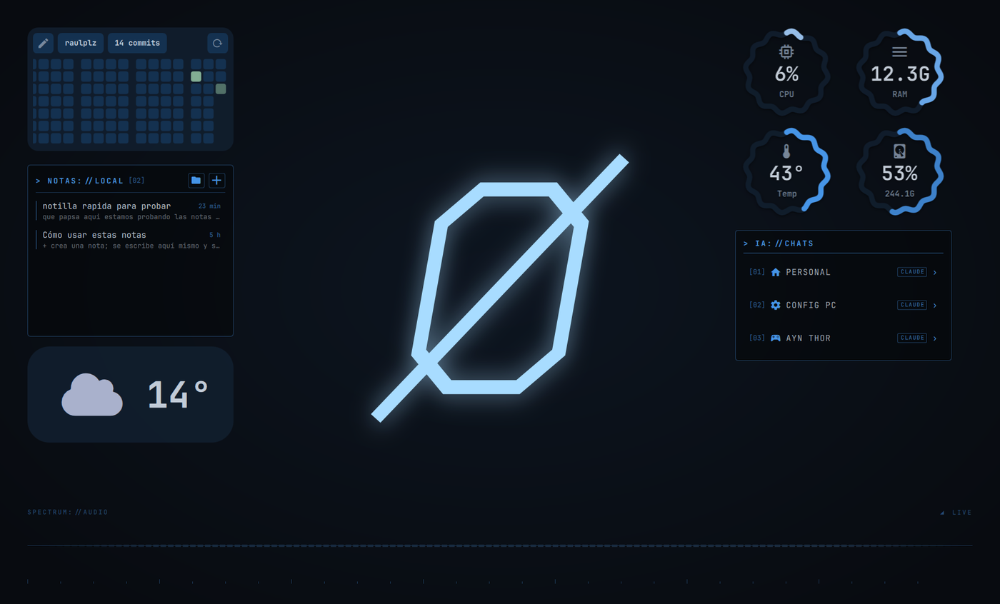

# Ø ZerØLayer

**ZeroLayer** (ZerØLayer) es una capa de estética **Frost** para [Omarchy](https://omarchy.org): azul hielo sobre negro, esquinas suaves, desenfoque, un arranque limpio y, si usas Serpantinum, un escritorio con widgets propios. No sustituye a Omarchy. Se instala encima, por módulos, y se puede deshacer entera.

> Antes se llamaba **FrostLayer**. Si lo tenías instalado, el instalador de una línea lo migra solo (carpeta, estado y bloques marcados) y el comando `frostlayer` sigue funcionando como alias de `zerolayer`.


## Instalar

En un Omarchy ya instalado:

```bash
curl -fsSL https://raw.githubusercontent.com/raulplz/ZeroLayer/main/install.sh | bash
```

Se abre un menú para elegir módulos (vienen marcados los de por defecto). Para instalar sin preguntas los módulos por defecto:

```bash
curl -fsSL https://raw.githubusercontent.com/raulplz/ZeroLayer/main/install.sh | bash -s -- --yes
```

El instalador clona el repositorio en `~/.local/share/zerolayer` y deja el comando `zerolayer` en `~/.local/bin`. No se ejecuta como root. Solo el módulo `boot` pide contraseña (una vez, para instalar su servicio), a través de la herramienta oficial de Omarchy.

¿Prefieres leer antes de ejecutar? Es buena idea:

```bash
git clone https://github.com/raulplz/ZeroLayer.git ~/.local/share/zerolayer
~/.local/share/zerolayer/bin/zerolayer install --dry-run
```

## Módulos

| Módulo | Por defecto | Qué hace |
|---|---|---|
| `theme` | sí | Seis temas ZERØ para Omarchy (`zero-frost`, `zero-corp`, `zero-neon`, `zero-phosphor`, `zero-amber`, `zero-void`) con paleta, fondo a la resolución de tu monitor e iconos de carpeta propios. Escribe `~/.config/zerolayer/theme.json` al cambiar de tema (ver «Temas ZERØ»). |
| `hyprland` | sí | Esquinas de 14 px, márgenes, desenfoque, atenuado leve de ventanas inactivas y animación de escritorios en deslizamiento. |
| `gtk` | sí | Colores Frost en aplicaciones GTK3/GTK4 (Nautilus, ajustes…). |
| `boot` | no | Arranque que sigue al tema activo: menú de Limine (colores, tu fondo de escritorio y datos del sistema) y pantallas de contraseña de disco y de sesión con el logo ZERØ. Pide sudo una vez para instalar un servicio de systemd. |
| `brave` | no | Brave más limpio: pestañas verticales plegadas, nueva pestaña Frost con solo el reloj, sin botones de Leo/Wallet/Rewards/News y ahorro de memoria. Brave debe estar cerrado. |
| `serpantinum` | no | Escritorio para [Serpantinum](https://github.com/ilyamiro/serpantinum): notas `.md`, chats destacados de Claude Code o Codex, tu GitHub, espectro de audio «hacker» y widgets solo en escritorios vacíos. Requiere Serpantinum instalado. |


## Temas ZERØ

El módulo `theme` instala seis temas completos de Omarchy. Cada uno trae su paleta, un fondo a la resolución de tu monitor (1920×1200, 1920×1080 o 2560×1440), sus iconos de carpeta y su vista previa. Por eso también aparecen en el menú nativo de temas de Omarchy (Super + Alt + Espacio → Estilo → Tema).

| Tema | Nombre | Acento | Idea |
|---|---|---|---|
| `zero-frost` | ZERØ Frost | `#4da3ff` | Azul hielo sobre negro, anillo HUD y circuitos. Es el de siempre. |
| `zero-corp` | ZERØ Corp | `#e8182c` | Rojo y negro corporativo, kanji 零, katakana y franjas de seguridad. |
| `zero-neon` | ZERØ Neon | `#ff2bd6` | Barrio de neón con lluvia y rejilla al horizonte; cian `#22e5ff` como segundo acento. |
| `zero-phosphor` | ZERØ Phosphor | `#39ff6a` | Terminal de fósforo verde, líneas de barrido y brillo de tubo. |
| `zero-amber` | ZERØ Amber | `#ffb000` | Laboratorio de señal en ámbar, retícula de osciloscopio. |
| `zero-void` | ZERØ Void | `#a879ff` | Vacío ultravioleta, nebulosa y un Ø enorme. |







### Cómo elegir

```bash
zerolayer theme               # menú: gum en la terminal, o el de imágenes de Omarchy sin terminal
zerolayer theme corp          # aplica uno por nombre (corp, zero-corp, neon…)
zerolayer theme list          # temas instalados; el activo lleva un punto
zerolayer theme status        # tema activo, si es ZERØ y la ruta y fecha de theme.json
zerolayer theme update        # regenera los temas instalados y reaplica el activo
zerolayer theme --menu        # fuerza el menú de imágenes (útil para un atajo de teclado)
```

Al instalar, si ya usas un tema ZERØ se queda; si no, arranca con `zero-frost`. Para empezar con otro: `ZEROLAYER_THEME=corp zerolayer install theme`.

### Qué hace el hook

El módulo instala el hook `~/.config/omarchy/hooks/theme-set.d/zerolayer-theme.hook`. Cada vez que cambia el tema de Omarchy, sea desde `zerolayer theme`, desde el menú nativo o con `omarchy-theme-set`, el hook escribe `~/.config/zerolayer/theme.json` con la paleta del tema activo, sea ZERØ o no. Si el módulo `gtk` está instalado, también recolorea GTK con esa paleta. Si tienes Serpantinum, el hook además escribe esa paleta en `theme.colors` de `~/.config/serpantinum/settings.json` (barra, paneles y notificaciones cambian en caliente; Serpantinum vigila ese archivo). La paleta que tenías se guarda antes del primer cambio y se devuelve al desinstalar. Para desactivarlo, añade `"themePalette": false` a `~/.config/zerolayer/serpantinum.json`.

Lo leen ZeroStudy, ZeroAgents y los widgets de Serpantinum, que cambian de color en caliente. El esquema y cómo leerlo desde otra app están en [docs/theme-json.md](docs/theme-json.md).

### Cómo deshacerlo

`zerolayer uninstall theme` quita el hook, los temas y los iconos ZERØ, devuelve la paleta original de Serpantinum y borra `theme.json`. Si sigues en un tema ZERØ, antes vuelve al tema y al fondo que tenías al instalar. Solo quita lo que lleva la marca `.zerolayer`; tus otros temas no se tocan. Si no había un tema anterior guardado (por ejemplo, instalaste estando ya en un tema ZERØ), elige otro en el menú de Omarchy.

Los fondos y las paletas se generan con `modules/theme/generar.py`. Para cambiar una paleta, edita `TEMAS` en ese archivo y regenera con `uv run --with pillow modules/theme/generar.py [id] [--solo-datos]`. Usar los temas no necesita nada de esto.

## Escritorio Serpantinum



El módulo `serpantinum` coloca una disposición Frost en el monitor activo, según el perfil que elijas, y añade widgets propios. Los widgets ZERØ leen la paleta de `theme.json`, así que siguen al tema activo sin reiniciar nada.

Los tres primeros son los de siempre:

- **Notas** (`NOTAS://LOCAL`): cada nota es un archivo `.md` suelto. «+» crea una, se escribe dentro del widget y se guarda sola; Esc vuelve a la lista; el lápiz la abre en tu editor de Omarchy; la papelera (dos clics) la mueve a `.papelera` en vez de borrarla. También lista `.txt`.
- **Chats IA** (`IA://CHATS`): hasta seis conversaciones destacadas de **Claude Code** o **Codex**. Un clic abre tu terminal en la carpeta de ese chat y lo reanuda (`claude --resume <id>` o `codex resume <id>`).
- **Espectro hacker**: barras cuadradas en bloques LED que crecen desde una línea central.

Además hay siete widgets nuevos para estudio, programación y juegos. Son solo de lectura salvo que se diga lo contrario:

| Widget | Qué muestra |
|---|---|
| **ZeroStudy** | Pendientes del día, racha, anillo de dominio y próximo plazo (rojo a 7 días o menos, ámbar a 21 o menos). Botones Repasar y Abrir. Lee el archivo que escribe la app ZeroStudy. |
| **Agenda** | Calendario del mes y los plazos de una tabla `.md` (`agendaFile`). |
| **Pomodoro** | Bloques de foco y descanso, con aviso por `notify-send`. |
| **Repos git** | Repos con cambios o commits sin subir. Clic abre `lazygit`. |
| **Docker** | Contenedores (`docker ps -a`), solo lectura. Usa el contexto `dockerContext`. |
| **ZeroAgents** | Abre el monitor de agentes (`zeroagents-gui` o `zeroagents`) y muestra las sesiones de Claude activas. |
| **Juegos** | Últimos juegos de Steam o Heroic, uso de GPU y batería del mando. |

Los widgets que ya había siguen igual: GitHub (compacto), Notas, Chats IA, Tiempo, Reloj, Música, Sistema (anillos de CPU, RAM, temperatura y disco) y Espectro.

### Perfiles

Un perfil es una disposición de widgets lista para usar. Elige el que más te sirva; después puedes quitar o añadir widgets a mano con el asistente.

| Perfil | Widgets | Para |
|---|---|---|
| `clasico` | GitHub, notas, tiempo, sistema, chats IA, espectro | El escritorio de la versión 0.2.0. Es el predeterminado. |
| `estudiante-dev` | El clásico más ZeroStudy | Estudiar y programar a la vez. |
| `estudiante` | ZeroStudy, agenda, pomodoro, notas, chats IA, espectro | Sesiones de estudio. |
| `dev` | GitHub, repos, Docker, sistema, ZeroAgents, chats IA, espectro | Trabajo con código y contenedores. |
| `gamer` | Reloj, juegos, música, sistema, tiempo, espectro | Juegos y música. |
| `basico` | Reloj, tiempo, agenda, música, notas, espectro | Lo justo. |

```bash
zerolayer configure widgets           # asistente (gum): perfil y ajuste widget a widget
zerolayer configure widgets dev       # aplica un perfil sin preguntas
```

El asistente pide, solo si faltan, los ajustes que necesitan algunos widgets: carpetas de repos (`reposDirs`), contexto de Docker (`dockerContext`) y el archivo de la agenda (`agendaFile`). Los tipos nuevos también aparecen en el editor gráfico de widgets de Serpantinum.

Todo queda en `~/.config/zerolayer/serpantinum.json`, junto a lo anterior. Sin el bloque `widgets`, se usa `clasico`:

```json
{
  "widgets": { "profile": "estudiante", "list": ["zerostudy", "agenda", "pomodoro", "notas", "chats", "espectro"] },
  "reposDirs": ["~/proyectos"],
  "dockerContext": "desktop-linux",
  "agendaFile": "~/Documentos/plazos.md",
  "pomodoro": { "focus": 25, "break": 5, "long": 15, "every": 4 }
}
```

Los tiempos de `pomodoro` van en minutos: `focus` es el bloque de foco, `break` el descanso corto, `long` el descanso largo y `every` cada cuántos bloques toca el largo.

Captura con el perfil `estudiante-dev` en ZERØ Frost (los datos de ejemplo son de demostración).

Además compacta el widget de **GitHub** para que quepa en 300 px y hace que los widgets solo se vean en un escritorio sin ventanas (Super + número de un escritorio vacío).

### Hazlo tuyo

Al instalar se abre un asistente; puedes repetirlo cuando quieras:

```bash
zerolayer configure serpantinum
```

Pregunta tu usuario de GitHub (propone el de `gh` si tienes sesión iniciada) y te enseña tus chats recientes de Claude Code y Codex para marcar los que quieres destacar. Solo lee metadatos de las sesiones (título, carpeta, fecha e id), nunca su contenido. En Claude Code salen primero las sesiones con nombre (`/rename`); en Codex, los hilos con nombre.

Todo queda en `~/.config/zerolayer/serpantinum.json`, que el escritorio relee en caliente. Puedes cambiar a mano el nombre (`label`) y el icono (`icon`, un glifo Nerd Font) de cada chat: si vuelves a pasar el asistente, los chats que sigan marcados conservan lo que hayas puesto.

```json
{
  "notesDir": "~/Notas",
  "githubUser": "tu-usuario",
  "chats": [
    { "agent": "claude", "id": "<id de sesión>", "label": "Mi proyecto", "cwd": "~/proyectos/web", "icon": "󰚩" },
    { "agent": "codex", "id": "<id de hilo>", "label": "Refactor", "cwd": "~/api" }
  ]
}
```

¿Otra IA? Añade un chat con `"command"`: se ejecuta con bash en `cwd` y recibe el id como `$1`, por ejemplo `{ "agent": "gemini", "id": "…", "label": "…", "command": "exec gemini --resume \"$1\"" }`.

Al actualizar Serpantinum se pierden los cambios en su código: vuelve a ejecutar `zerolayer install serpantinum`. Desinstalar devuelve el código de Serpantinum a su estado original y recupera tu disposición anterior; tus notas y la configuración se quedan.

### Arranque con tema (módulo `boot`)

`zerolayer install boot` instala el servicio `zerolayer-boot` (systemd, como root). Vigila `~/.config/zerolayer/theme.json` y, al cambiar de tema, reescribe la cabecera de `/boot/limine.conf` (paleta, marca, fondo), la pantalla de contraseña de disco (Plymouth) y la de sesión (SDDM); regenerar la imagen de arranque tarda ~1 min. Si `omarchy update` restaura la pantalla de Omarchy, se vuelve a aplicar sola.

Seguridad: del `theme.json` solo se aceptan colores `#RRGGBB`, un id `[a-z0-9-]` y un nombre saneado; tu fondo se lee con tus permisos y solo si es un PNG o JPEG. Las entradas de arranque no se tocan y la `limine.conf` original queda en `/var/lib/zerolayer-boot/`. Estado: `journalctl -u zerolayer-boot`; deshacer: `zerolayer uninstall boot`.

## Uso

```bash
zerolayer install [módulo…]     # sin nombres: menú
zerolayer uninstall [módulo…]   # sin nombres: todo lo instalado
zerolayer status                # qué está aplicado
zerolayer list                  # módulos disponibles
zerolayer configure serpantinum # tu GitHub y tus chats de IA destacados
zerolayer configure widgets [perfil] # perfil de widgets del escritorio (asistente si no das perfil)
zerolayer theme [id|list|status|update|--menu]  # temas ZERØ: menú, aplicar, listar, estado o regenerar
zerolayer update                # baja la última versión y reaplica lo instalado
```

Opciones: `--yes` (sin preguntas) y `--dry-run` (muestra lo que haría sin tocar nada).

Ejemplos: `zerolayer install boot`, `ZEROLAYER_LOGO=~/mi-logo.png zerolayer install boot`.

## Cómo cuida tu sistema

- **Copias antes de tocar.** Cada archivo modificado se guarda en `~/.local/state/zerolayer/backups/`.
- **Bloques marcados.** En `hyprland.lua` y `gtk.css` solo añade un bloque entre `>>> ZeroLayer` y `<<< ZeroLayer`. En Serpantinum, cada línea cambiada lleva la marca `ZeroLayer` y se deshace una a una. Tu configuración no se reescribe y reinstalar no duplica nada.
- **Deshacer de verdad.** `zerolayer uninstall` devuelve los archivos a su estado anterior, vuelve a tu tema previo de Omarchy y quita solo lo que ZerØLayer creó.
- **Hyprland con red.** Si la configuración Frost diera error al recargar, se retira sola.
- Tras un `omarchy update`, Omarchy puede restaurar su pantalla de arranque. Basta con `zerolayer install boot`.

## Qué no incluye (todavía)

- **Serpantinum en sí.** El módulo `serpantinum` solo añade widgets y ajustes encima; Serpantinum se instala desde su proyecto.
- **Configuración personal**: monitores, paquetes, atajos propios o datos de navegador. ZerØLayer es solo estética y no copia nada de nadie.
- **Tema de color de Brave.** Brave lo protege y lo restaura al arrancar. Se elige a mano en *Ajustes → Apariencia → Personalizar* con `#4DA3FF`.

## Requisitos

Omarchy reciente (configuración de Hyprland en Lua), `git` y `gum` (ya vienen con Omarchy). `python3` para los módulos `brave` y `serpantinum`. Probado en Omarchy 4.0 y Serpantinum 2.3.0.

Para probarlo fuera de Omarchy, bajo tu responsabilidad: `ZEROLAYER_FORCE=1`.

## Estructura

```
install.sh            instalador de una línea
bin/zerolayer         CLI
lib/common.sh         copias, bloques marcados, estado, --dry-run
modules/<nombre>/     module.sh (check · apply · revert) y sus archivos
```

Añadir un módulo es crear `modules/<nombre>/module.sh` con `MODULE_DESC`, `MODULE_DEFAULT` y las funciones `module_check`, `module_apply` y `module_revert`.

---

## English

**ZeroLayer** (ZerØLayer, formerly FrostLayer) is a modular look for [Omarchy](https://omarchy.org). Version 0.3.1 ships six ZERØ themes (Frost, Corp, Neon, Phosphor, Amber, Void) with wallpapers sized to your monitor and folder icons; a hook keeps `~/.config/zerolayer/theme.json`, GTK and the Serpantinum palette in sync with whichever Omarchy theme is active (`zerolayer theme`, `zerolayer theme status`). It also adds Hyprland polish, an optional ZERØ boot screen, an optional cleaner Brave and an optional Serpantinum desktop with 15 widgets and six profiles (`zerolayer configure widgets`). Every change is backed up, wrapped in marked blocks and fully reversible.

```bash
curl -fsSL https://raw.githubusercontent.com/raulplz/ZeroLayer/main/install.sh | bash
zerolayer status
zerolayer uninstall
```

Use `--dry-run` to preview and `--yes` for non-interactive installs. The UI is in Spanish.

## Licencia

[MIT](LICENSE). Fondo, iconos de carpeta y logo ZERØ son originales de este proyecto y se distribuyen con la misma licencia. Los iconos base vienen de Yaru y Breeze, que se instalan como paquetes de tu distribución.

Excepción: `modules/serpantinum/` modifica y amplía [Serpantinum](https://github.com/ilyamiro/serpantinum), que es AGPL-3.0, así que esa carpeta se distribuye bajo **AGPL-3.0** ([texto](modules/serpantinum/LICENSE.md)).
