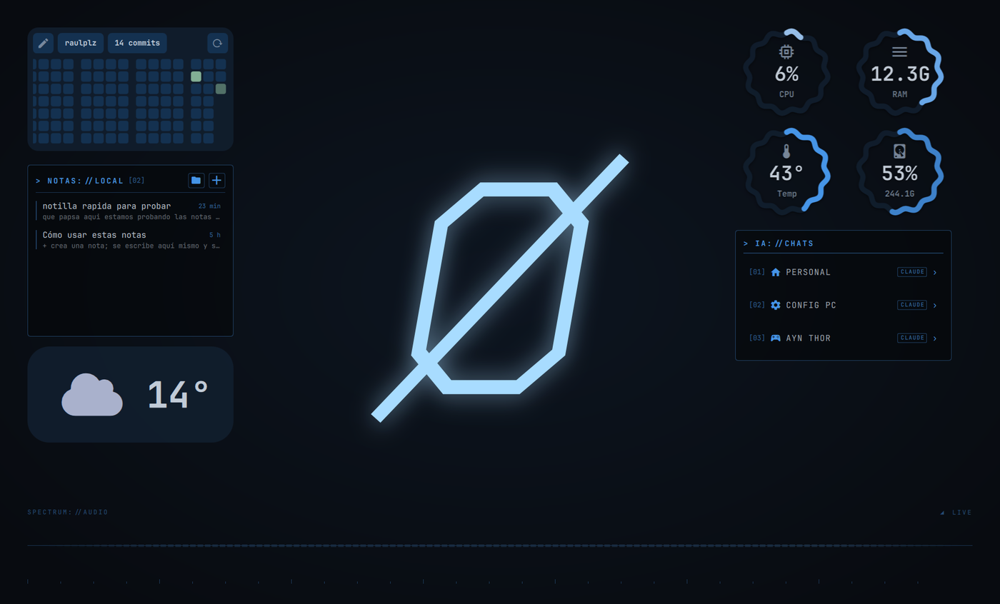

# Ø ZerØLayer

**ZeroLayer** (ZerØLayer) es una capa de estética **Frost** para [Omarchy](https://omarchy.org): azul hielo sobre negro, esquinas suaves, desenfoque, un arranque limpio y, si usas Serpantinum, un escritorio con widgets propios. No sustituye a Omarchy. Se instala encima, por módulos, y se puede deshacer entera.

> Antes se llamaba **FrostLayer**. Si lo tenías instalado, el instalador de una línea lo migra solo (carpeta, estado y bloques marcados) y el comando `frostlayer` sigue funcionando como alias de `zerolayer`.


## Instalar

En un Omarchy ya instalado:

```bash
curl -fsSL https://raw.githubusercontent.com/raulplz/ZeroLayer/main/install.sh | bash
```

Se abre un menú para elegir módulos (vienen marcados los de por defecto). Para instalar sin preguntas los módulos por defecto:

```bash
curl -fsSL https://raw.githubusercontent.com/raulplz/ZeroLayer/main/install.sh | bash -s -- --yes
```

El instalador clona el repositorio en `~/.local/share/zerolayer` y deja el comando `zerolayer` en `~/.local/bin`. No se ejecuta como root. Solo el módulo `boot` pide contraseña, a través de la herramienta oficial de Omarchy.

¿Prefieres leer antes de ejecutar? Es buena idea:

```bash
git clone https://github.com/raulplz/ZeroLayer.git ~/.local/share/zerolayer
~/.local/share/zerolayer/bin/zerolayer install --dry-run
```

## Módulos

| Módulo | Por defecto | Qué hace |
|---|---|---|
| `theme` | sí | Tema de Omarchy `frost`: paleta, fondo propio e iconos de carpeta Frost (sobre Yaru-blue). |
| `hyprland` | sí | Esquinas de 14 px, márgenes, desenfoque, atenuado leve de ventanas inactivas y animación de escritorios en deslizamiento. |
| `gtk` | sí | Colores Frost en aplicaciones GTK3/GTK4 (Nautilus, ajustes…). |
| `boot` | no | Pantalla de arranque y desbloqueo con el logo ZERØ. Pide sudo y regenera la imagen de arranque. |
| `brave` | no | Brave más limpio: pestañas verticales plegadas, nueva pestaña Frost con solo el reloj, sin botones de Leo/Wallet/Rewards/News y ahorro de memoria. Brave debe estar cerrado. |
| `serpantinum` | no | Escritorio para [Serpantinum](https://github.com/ilyamiro/serpantinum): notas `.md`, chats destacados de Claude Code o Codex, tu GitHub, espectro de audio «hacker» y widgets solo en escritorios vacíos. Requiere Serpantinum instalado. |


## Escritorio Serpantinum



El módulo `serpantinum` coloca una disposición Frost en el monitor activo y añade tres widgets:

- **Notas** (`NOTAS://LOCAL`): cada nota es un archivo `.md` suelto. «+» crea una, se escribe dentro del widget y se guarda sola; Esc vuelve a la lista; el lápiz la abre en tu editor de Omarchy; la papelera (dos clics) la mueve a `.papelera` en vez de borrarla. También lista `.txt`.
- **Chats IA** (`IA://CHATS`): hasta seis conversaciones destacadas de **Claude Code** o **Codex**. Un clic abre tu terminal en la carpeta de ese chat y lo reanuda (`claude --resume <id>` o `codex resume <id>`).
- **Espectro hacker**: barras cuadradas en bloques LED que crecen desde una línea central.

Además compacta el widget de **GitHub** para que quepa en 300 px y hace que los widgets solo se vean en un escritorio sin ventanas (Super + número de un escritorio vacío).

### Hazlo tuyo

Al instalar se abre un asistente; puedes repetirlo cuando quieras:

```bash
zerolayer configure serpantinum
```

Pregunta tu usuario de GitHub (propone el de `gh` si tienes sesión iniciada) y te enseña tus chats recientes de Claude Code y Codex para marcar los que quieres destacar. Solo lee metadatos de las sesiones (título, carpeta, fecha e id), nunca su contenido. En Claude Code salen primero las sesiones con nombre (`/rename`); en Codex, los hilos con nombre.

Todo queda en `~/.config/zerolayer/serpantinum.json`, que el escritorio relee en caliente:

```json
{
  "notesDir": "~/Notas",
  "githubUser": "tu-usuario",
  "chats": [
    { "agent": "claude", "id": "<id de sesión>", "label": "Mi proyecto", "cwd": "~/proyectos/web", "icon": "󰚩" },
    { "agent": "codex", "id": "<id de hilo>", "label": "Refactor", "cwd": "~/api" }
  ]
}
```

¿Otra IA? Añade un chat con `"command"`: se ejecuta con bash en `cwd` y recibe el id como `$1`, por ejemplo `{ "agent": "gemini", "id": "…", "label": "…", "command": "exec gemini --resume \"$1\"" }`.

Al actualizar Serpantinum se pierden los cambios en su código: vuelve a ejecutar `zerolayer install serpantinum`. Desinstalar devuelve el código de Serpantinum a su estado original y recupera tu disposición anterior; tus notas y la configuración se quedan.

## Uso

```bash
zerolayer install [módulo…]     # sin nombres: menú
zerolayer uninstall [módulo…]   # sin nombres: todo lo instalado
zerolayer status                # qué está aplicado
zerolayer list                  # módulos disponibles
zerolayer configure serpantinum # tu GitHub y tus chats de IA destacados
zerolayer update                # baja la última versión y reaplica lo instalado
```

Opciones: `--yes` (sin preguntas) y `--dry-run` (muestra lo que haría sin tocar nada).

Ejemplos: `zerolayer install boot`, `ZEROLAYER_LOGO=~/mi-logo.png zerolayer install boot`.

## Cómo cuida tu sistema

- **Copias antes de tocar.** Cada archivo modificado se guarda en `~/.local/state/zerolayer/backups/`.
- **Bloques marcados.** En `hyprland.lua` y `gtk.css` solo añade un bloque entre `>>> ZeroLayer` y `<<< ZeroLayer`. En Serpantinum, cada línea cambiada lleva la marca `ZeroLayer` y se deshace una a una. Tu configuración no se reescribe y reinstalar no duplica nada.
- **Deshacer de verdad.** `zerolayer uninstall` devuelve los archivos a su estado anterior, vuelve a tu tema previo de Omarchy y quita solo lo que ZerØLayer creó.
- **Hyprland con red.** Si la configuración Frost diera error al recargar, se retira sola.
- Tras un `omarchy update`, Omarchy puede restaurar su pantalla de arranque. Basta con `zerolayer install boot`.

## Qué no incluye (todavía)

- **Serpantinum en sí.** El módulo `serpantinum` solo añade widgets y ajustes encima; Serpantinum se instala desde su proyecto.
- **Configuración personal**: monitores, paquetes, atajos propios o datos de navegador. ZerØLayer es solo estética y no copia nada de nadie.
- **Tema de color de Brave.** Brave lo protege y lo restaura al arrancar. Se elige a mano en *Ajustes → Apariencia → Personalizar* con `#4DA3FF`.

## Requisitos

Omarchy reciente (configuración de Hyprland en Lua), `git` y `gum` (ya vienen con Omarchy). `python3` para los módulos `brave` y `serpantinum`. Probado en Omarchy 4.0 y Serpantinum 2.3.0.

Para probarlo fuera de Omarchy, bajo tu responsabilidad: `ZEROLAYER_FORCE=1`.

## Estructura

```
install.sh            instalador de una línea
bin/zerolayer         CLI
lib/common.sh         copias, bloques marcados, estado, --dry-run
modules/<nombre>/     module.sh (check · apply · revert) y sus archivos
```

Añadir un módulo es crear `modules/<nombre>/module.sh` con `MODULE_DESC`, `MODULE_DEFAULT` y las funciones `module_check`, `module_apply` y `module_revert`.

---

## English

**ZeroLayer** (ZerØLayer, formerly FrostLayer) is a modular **Frost** look for [Omarchy](https://omarchy.org): an Omarchy theme with custom wallpaper and folder icons, Hyprland polish, GTK colours, an optional ZERØ boot screen, an optional cleaner Brave and an optional Serpantinum desktop (Markdown notes, your GitHub contributions, pinned Claude Code or Codex chats and a LED-style audio spectrum; `zerolayer configure serpantinum` sets it up for you). Every change is backed up, wrapped in marked blocks and fully reversible.

```bash
curl -fsSL https://raw.githubusercontent.com/raulplz/ZeroLayer/main/install.sh | bash
zerolayer status
zerolayer uninstall
```

Use `--dry-run` to preview and `--yes` for non-interactive installs. The UI is in Spanish.

## Licencia

[MIT](LICENSE). Fondo, iconos de carpeta y logo ZERØ son originales de este proyecto y se distribuyen con la misma licencia. Los iconos base vienen de Yaru y Breeze, que se instalan como paquetes de tu distribución.

Excepción: `modules/serpantinum/` modifica y amplía [Serpantinum](https://github.com/ilyamiro/serpantinum), que es AGPL-3.0, así que esa carpeta se distribuye bajo **AGPL-3.0** ([texto](modules/serpantinum/LICENSE.md)).
